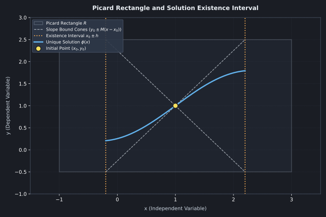

# Existência e Unicidade de Soluções: O Teorema de Picard-Lindelöf

## Motivação e Contexto

Ao estudar equações diferenciais ordinárias, o objetivo principal costuma ser encontrar uma fórmula para a função $y(x)$. No entanto, antes de gastar tempo tentando resolver um Problema de Valor Inicial (PVI), é fundamental responder a duas perguntas fundamentais:

1. **Existe uma solução?** O problema realmente possui algum caminho válido a partir do ponto inicial dado?
2. **A solução é única?** Existe apenas um único caminho possível, ou o sistema pode se dividir em múltiplos caminhos diferentes?

Garantir a **existência** garante que o modelo matemático faz sentido e tem resposta. Garantir a **unicidade** garante o determinismo do sistema: dado um estado inicial exato, o comportamento futuro é perfeitamente previsível e possui apenas um destino. O **Teorema de Picard-Lindelöf** estabelece as condições simples sob as quais ambas as garantias são confirmadas.

## Formulação Teórica

### O Retângulo de Picard e a Intuição Geométrica

Considere o Problema de Valor Inicial (PVI) de primeira ordem na forma normal:

$$\begin{cases} 
\dfrac{dy}{dx} = f(x, y) \\ 
y(x_0) = y_0 
\end{cases}$$

Para analisar se existe solução ao redor do ponto inicial $(x_0, y_0)$, desenhamos uma pequena região de análise no plano $xy$: um **retângulo fechado $R$** centrado no ponto $(x_0, y_0)$, definido por:

$$R = \{ (x, y) \in \mathbb{R}^2 : |x - x_0| \le a, \; |y - y_0| \le b \}$$

onde $a$ é a meia-largura horizontal e $b$ é a meia-altura vertical.

Como a função $f(x, y)$ representa a inclinação da reta tangente em cada ponto, existe um valor máximo para essa inclinação dentro do retângulo $R$, o qual chamamos de $M$:

$$M = \max_{(x,y) \in R} |f(x, y)|$$

Esse limite de inclinação $M$ cria um "cone de velocidade": a solução $y(x)$ não pode subir ou descer mais rápido do que a inclinação $M$. Com isso, garante-se que a curva da solução permanecerá dentro do retângulo pelo menos até a variável $x$ atingir a distância $h = \min\left(a, \frac{b}{M}\right)$ a partir de $x_0$.

*Figura 1: O Retângulo de Picard R centrado no ponto inicial (x₀, y₀). O valor M representa a inclinação máxima dentro do retângulo e limita a trajetória da solução dentro do cone tracejado. A solução y(x) fica garantida dentro do intervalo x₀ ± h.*

---

### A Hierarquia dos Teoremas: De Bolzano a Picard-Lindelöf

A análise de existência e unicidade segue uma evolução natural de rigor que aproveita conceitos fundamentais do Cálculo:

#### 1. A Analogia com o Cálculo 1 (Teorema de Bolzano)

No Cálculo de uma variável, o **Teorema do Valor Intermediário (Bolzano)** garante que se uma função $f(x)$ for contínua em um intervalo $[a, b]$ e mudar de sinal, ela obrigatoriamente cruza o eixo zero. A continuidade impede que a função "salte" por cima do zero.

#### 2. Garantia de Existência em 2D (Teorema de Peano)

O **Teorema de Peano** é a extensão direta da ideia de Bolzano para equações diferenciais. Se a função $f(x, y)$ for **contínua** no retângulo $R$, o campo de direções não possui "furos" ou "rasgões". Isso força a existência de **pelo menos uma solução** $y = \phi(x)$ no intervalo $|x - x_0| \le h$.
* *Ideia prática:* Peano garante que podemos desenhar pelo menos uma trajetória fluida, mas não impede que duas trajetórias se cruzem no mesmo ponto inicial.

#### 3. Garantia de Unicidade (Teorema de Picard-Lindelöf)

Se, além de $f(x, y)$ ser contínua, a sua derivada parcial $\dfrac{\partial f}{\partial y}$ também for **contínua** no retângulo $R$, o Teorema de Picard-Lindelöf garante que a solução $y = \phi(x)$ é **estritamente única** no intervalo $|x - x_0| \le h$.
* *Ideia prática:* A continuidade de $\dfrac{\partial f}{\partial y}$ impede que as inclinações façam "saltos verticais", garantindo que curvas vizinhas nunca se cruzem ou bifurquem.

---

### A Condição de Lipschitz (A Mudança Suave de Inclinações)

Dizemos que uma função $f(x, y)$ satisfaz a **Condição de Lipschitz** na variável $y$ se existir uma constante positiva $K$ tal que:

$$|f(x, y_1) - f(x, y_2)| \le K |y_1 - y_2|$$

Em termos simples: se você ajustar ligeiramente o valor de $y$, a inclinação dada por $f(x, y)$ mudará de forma proporcional e controlada. Quando a derivada parcial $\dfrac{\partial f}{\partial y}$ é contínua em um retângulo fechado, a condição de Lipschitz é automaticamente satisfeita.

---

## O Método das Aproximações Sucessivas de Picard

O Teorema de Picard-Lindelöf não apenas prova que a solução existe, mas também oferece uma forma prática de construí-la passo a passo. 

Primeiro, reescrevemos o PVI como uma equação integral equivalente:

$$y(x) = y_0 + \int_{x_0}^{x} f(t, y(t)) \, dt$$

Em seguida, partimos de um palpite inicial muito simples: $\phi_0(x) = y_0$. A partir dele, calculamos uma sequência de funções aproximadas $\{\phi_n(x)\}$ usando a fórmula iterativa:

$$\phi_{n+1}(x) = y_0 + \int_{x_0}^{x} f(t, \phi_n(t)) \, dt, \quad n = 0, 1, 2, \dots$$

À medida que $n$ cresce, a sequência de aproximações $\phi_1(x), \phi_2(x), \phi_3(x), \dots$ se aproxima cada vez mais da solução exata do PVI.

---

## Exemplos Resolvidos

### Exemplo 1: Quando a Unicidade Falha

Considere o Problema de Valor Inicial:

$$\dfrac{dy}{dx} = 3 y^{2/3}, \quad y(0) = 0$$

Verifique se este problema atende às condições do Teorema de Picard-Lindelöf.

**Resolução:**
1. **Diferenciando o "Avaliador de Inclinações" $f(x,y)$ da "Solução" $y(x)$:**
   * Na EDO $\dfrac{dy}{dx} = f(x, y)$, a expressão do lado direito $f(x, y) = 3y^{2/3}$ representa a **função campo de direções** (uma função de duas variáveis no plano $xy$).
   * *Atenção:* Ao analisar $f(x, y)$, a variável $y$ é tratada temporariamente apenas como a **coordenada do eixo vertical** do plano, e não como a função solução $y(x)$ que ainda queremos encontrar.

2. **Testando a continuidade da função campo $f(x, y)$:**
   * A função de duas variáveis $f(x, y) = 3y^{2/3}$ envolve apenas a operação de raiz cúbica e elevação ao quadrado em relação à coordenada $y$.
   * Como $3y^{2/3}$ está definida e não possui divisões por zero ou raízes de índice par para nenhum valor de $y$, a função $f(x, y)$ é **contínua em todo o plano $\mathbb{R}^2$**.
   * Pelo Teorema de Peano, como a função campo $f(x, y)$ é contínua no ponto inicial $(0,0)$, temos a certeza de que **existe pelo menos uma solução** $y(x)$ passando por esse ponto.

3. **Testando a derivada parcial $\dfrac{\partial f}{\partial y}$:**

   $$\dfrac{\partial f}{\partial y} = \dfrac{d}{dy}\left(3y^{2/3}\right) = \dfrac{2}{y^{1/3}}$$

4. **Avaliando no ponto inicial $(0, 0)$:**
   * Ao avaliar a derivada parcial no ponto inicial $y_0 = 0$, a expressão $\dfrac{2}{0^{1/3}}$ resulta em uma divisão por zero (tende ao infinito).

5. **Conclusão:**
   * A derivada parcial $\dfrac{\partial f}{\partial y}$ não é contínua na linha $y = 0$.
   * Portanto, o Teorema de Picard-Lindelöf **não garante unicidade**. Como verificado previamente, existem duas soluções válidas passando por $(0,0)$: a solução trivial $y_1(x) = 0$ e a curva $y_2(x) = x^3$.
---

### Exemplo 2: Construindo uma Solução Passo a Passo (Iteração de Picard)

Use o método das aproximações sucessivas de Picard para resolver o PVI:

$$\dfrac{dy}{dx} = 2x(1 + y), \quad y(0) = 0$$

**Resolução:**
1. **Palpite Inicial ($n=0$):**  
   $\phi_0(x) = y_0 = 0$.

2. **Primeira Aproximação ($n=1$):**  
   $$\phi_1(x) = 0 + \int_{0}^{x} 2t(1 + 0) \, dt = \int_{0}^{x} 2t \, dt = x^2$$

3. **Segunda Aproximação ($n=2$):**  
   $$\phi_2(x) = \int_{0}^{x} 2t(1 + t^2) \, dt = \int_{0}^{x} (2t + 2t^3) \, dt = x^2 + \frac{x^4}{2}$$

4. **Terceira Aproximação ($n=3$):**  
   $$\phi_3(x) = \int_{0}^{x} 2t\left(1 + t^2 + \frac{t^4}{2}\right) \, dt = x^2 + \frac{x^4}{2} + \frac{x^6}{6}$$

5. **Identificando o Padrão:**  
   Note que os termos gerados correspondem exatamente à expansão em série de Taylor da função $e^{x^2} - 1$:

   $$\phi(x) = x^2 + \frac{x^4}{2!} + \frac{x^6}{3!} + \dots = e^{x^2} - 1$$

Como a derivada $\dfrac{\partial f}{\partial y} = 2x$ é contínua em todo o plano, a função $y(x) = e^{x^2} - 1$ é a **única** solução possível para este PVI.

---

## Aplicações Práticas

### Previsibilidade em Sistemas Físicos
Na física clássica, saber que um PVI possui solução única significa que o comportamento de um sistema dinâmico (como um pêndulo, um circuito elétrico ou um planeta em órbita) é completamente previsível a partir de suas condições iniciais.

### Estabilidade em Simuladores Numéricos
Softwares de simulação (como integradores numéricos de engenharia) dependem da condição de Lipschitz para evitar que pequenos erros de arredondamento façam o cálculo oscilar descontroladamente.