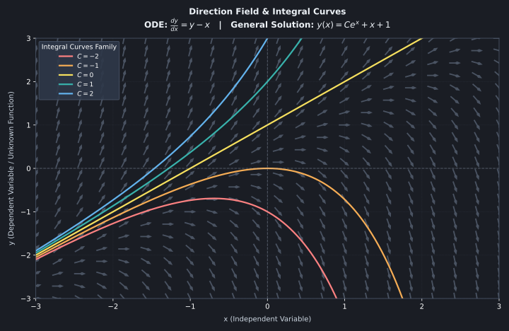
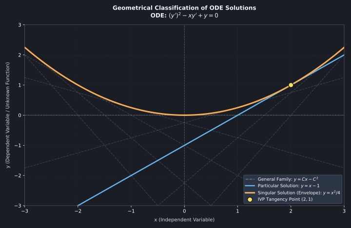

# Natureza e Geometria das Soluções de Equações Diferenciais Ordinárias

## Motivação e Contexto

Na álgebra elementar, a solução de uma equação é um número real ou complexo que satisfaz uma igualdade estática. Ao avançar para equações diferenciais ordinárias, ocorre uma mudança fundamental de paradigma: a incógnita deixa de ser um ponto estático e passa a ser uma função suave $y = \phi(x)$ definida em um intervalo aberto $I \subset \mathbb{R}$.

O desafio analítico surge do fato de que uma EDO não prescreve diretamente o valor da função, mas sim uma restrição local entre a variável independente, a função e suas taxas de variação instantâneas. Sem a compreensão rigorosa do que constitui uma solução sob a ótica geométrica e topológica, o processo de integração converte-se em manipulação algébrica cega, ocultando fenômenos como perda de domínio, bifurcações e soluções singulares não detectáveis por métodos operacionais padrão.

## Formulação Teórica

### Definição Formal de Solução

Seja uma EDO de ordem $n$ expressa na forma implícita:

$$F\left(x, y, y', y'', \dots, y^{(n)}\right) = 0$$

Uma função $\phi: I \to \mathbb{R}$, onde $I \subset \mathbb{R}$ é um intervalo aberto, é dita uma **solução explícita** da EDO no intervalo $I$ se:
1. $\phi$ possui derivadas contínuas até a ordem $n$ em todo $x \in I$ ($\phi \in C^n(I)$).
2. A substituição de $y = \phi(x)$ e suas derivadas reduz a equação a uma identidade em $I$:

$$F\left(x, \phi(x), \phi'(x), \dots, \phi^{(n)}(x)\right) = 0, \quad \forall x \in I$$

O par $(\phi, I)$ define rigorosamente a solução. O intervalo de definição $I$ é indissociável da solução matemática.

### A Origem da Família de Funções vs. A Incógnita do PVI

Uma dúvida conceitual recorrente é entender por que o processo de resolução de uma EDO resulta em uma **família infinita de funções** $y = \Phi(x, C_1, \dots, C_n)$, embora a incógnita física ou matemática do problema seja uma única função $y(x)$.

A razão reside na natureza local da diferenciação. A EDO impõe uma regra apenas sobre a **inclinação e a curvatura** da solução, mas não fixa a sua posição absoluta no espaço de fase. O processo de integração desfaz a operação de derivação, introduzindo $n$ constantes arbitrárias $C_1, \dots, C_n$. 

Geometricamente, a EDO gera um **espaço de soluções** composto por infinitas curvas integrais paralelas ou deformadas. Uma **única trajetória individual** só é isolada quando fixamos condições de contorno ou um Problema de Valor Inicial (PVI), onde a imposição $y(x_0) = y_0$ seleciona a única curva integral da família que passa rigorosamente pelo ponto $(x_0, y_0)$.

### Desmistificando a Forma Normal $y' = f(x, y)$: EDO vs. Cálculo Multivariável

É frequente a confusão conceitual ao observar a forma normal de primeira ordem $y' = f(x, y)$ e interpretar $f(x, y)$ como uma função de duas variáveis independentes que tornaria o problema uma Equação Diferencial Parcial (EDP).

É fundamental distinguir o **mecanismo de avaliação da inclinação** da **natureza da solução**:
1. Na expressão $y' = f(x, y)$, as variáveis $x$ e $y$ **não são independentes entre si**. A variável $x$ é a única variável independente, enquanto $y$ é implicitamente uma função de $x$, ou seja, $y = y(x)$.
2. A função $f: \mathbb{R}^2 \to \mathbb{R}$ atua apenas como uma "máquina de calcular inclinações": ela recebe a posição atual no plano $(x, y(x))$ e retorna o número real que representa a derivada $y'(x)$ naquele ponto.
3. A solução buscada $y(x)$ permanece sendo uma função de **uma única variável real**. A derivada envolvida é uma **derivada total** ($\frac{dy}{dx}$), e não uma derivada parcial ($\frac{\partial y}{\partial x}$). Uma EDP só emergiria se a função incógnita dependesse explicitamente de duas ou mais variáveis independentes $u(x, t)$, exigindo derivadas parciais como $\frac{\partial u}{\partial t}$ e $\frac{\partial^2 u}{\partial x^2}$.

### Representação Implícita e Curvas Integrais

Frequentemente, a integração de uma EDO resulta em uma relação funcional $G(x, y) = 0$ na qual não é viável ou conveniente isolar $y(x)$. Diz-se que $G(x, y) = 0$ é uma **solução implícita** no intervalo $I$ se existir pelo menos uma função $y = \phi(x)$ definida em $I$ tal que $G(x, \phi(x)) = 0$ e $\phi(x)$ seja uma solução explícita da EDO.

Geometricamente, o gráfico de uma solução $\phi(x)$ representa uma **curva integral** no plano $xy$. Para uma EDO de primeira ordem na forma normal $y' = f(x, y)$, a função $f(x, y)$ associa a cada ponto $(x, y)$ um escalar que representa a inclinação da reta tangente à curva integral que passa por esse ponto. O conjunto dessas inclinações forma o **campo de direções** do sistema.

*Figura 1: Campo de direções e família de curvas integrais para a EDO dy/dx = y - x. Os vetores cinzas (campo de direções) indicam a inclinação local y' em cada ponto. As curvas coloridas representam a solução geral y(x) = C e^x + x + 1 para diferentes valores de C, com a reta amarela (C = 0) atuando como separatriz.*

### Classificação do Espaço de Soluções

1. **Solução Geral:** Família $n$-paramétrica de funções $y = \Phi(x, C_1, C_2, \dots, C_n)$ contendo $n$ constantes arbitrárias independentes, obtida pela integração geral de uma EDO de ordem $n$.
2. **Solução Particular:** Uma função obtida ao atribuir valores específicos às constantes $C_1, \dots, C_n$, tipicamente determinados pela imposição de condições iniciais no ponto $x_0 \in I$:

$$y(x_0) = y_0, \quad y'(x_0) = y_1, \quad \dots, \quad y^{(n-1)}(x_0) = y_{n-1}$$

3. **Solução Singular:** Uma solução que não pode ser obtida por nenhuma escolha de constantes na família da solução geral. Geometricamente, soluções singulares surgem como envelopes da família de curvas integrais.

*Figura 2: Classificação geométrica das soluções para a EDO (y')² - x y' + y = 0. As linhas tracejadas cinzas representam a Solução Geral (família de retas y = Cx - C²), a linha azul destaca a Solução Particular (y = x - 1) para o PVI em (2,1), e a parábola laranja representa a Solução Singular (y = x²/4), que atua como envelope tangencial que toca a reta azul no ponto (2,1).*
## Exemplos e Problemas Resolvidos

### Exemplo 1: Verificação Rigorosa e Restrição do Intervalo Maximal

Considere a EDO não linear de primeira ordem:

$$y' + y^2 = 0$$

Mostre que a função candidata $y(x) = \frac{1}{x + C}$ é uma família de soluções e determine o intervalo de definição da solução particular submetida à condição inicial $y(0) = -2$.

**Resolução:**
1. **Verificação da Família Candidata:**
   Dada $\phi(x) = (x + C)^{-1}$, sua derivada com respeito a $x$ é:

   $$\phi'(x) = -\frac{1}{(x + C)^2}$$

   Substituindo $\phi(x)$ e $\phi'(x)$ na EDO:

   $$\phi'(x) + [\phi(x)]^2 = -\frac{1}{(x + C)^2} + \left(\frac{1}{x + C}\right)^2 = 0$$

   A identidade é satisfeita para todo $x \neq -C$.

2. **Aplicação da Condição Inicial:**
   Para $y(0) = -2$:

   $$-2 = \frac{1}{0 + C} \implies C = -\frac{1}{2}$$

   A solução particular é dada por:

   $$y(x) = \frac{1}{x - 1/2} = \frac{2}{2x - 1}$$

3. **Determinação do Intervalo Maximal $I$:**
   A fórmula algébrica possui uma assíntota vertical em $x = 1/2$, o que divide o domínio real em duas regiões desconectadas: $(-\infty, 1/2)$ e $(1/2, \infty)$. 
   
   Como a definição formal de solução exige um intervalo contínuo aberto contendo o ponto inicial $x_0 = 0$, selecionamos o subintervalo que contém a origem. Portanto, o intervalo maximal de validade da solução é:

   $$I = \left(-\infty, \frac{1}{2}\right)$$

### Exemplo 2: Verificação de Múltiplas Soluções e Múltiplas Trajetórias

Considere o Problema de Valor Inicial (PVI) definido por:

$$y' = 3 y^{2/3}, \quad y(0) = 0$$

Dadas as duas funções candidatas $y_1(x) = 0$ e $y_2(x) = x^3$, verifique se ambas são soluções do mesmo PVI e analise o comportamento geométrico do resultado.

**Resolução:**
1. **Verificação da Função $y_1(x) = 0$:**
   * Condição Inicial: $y_1(0) = 0$ (Satisfeita).
   * Derivada: $y_1'(x) = 0$.
   * Substituição na EDO: $0 = 3(0)^{2/3} \implies 0 = 0$ (Identidade válida para todo $x \in \mathbb{R}$).

2. **Verificação da Função $y_2(x) = x^3$:**
   * Condição Inicial: $y_2(0) = 0^3 = 0$ (Satisfeita).
   * Derivada: $y_2'(x) = 3x^2$.
   * Substituição na EDO: $3x^2 = 3(x^3)^{2/3} \implies 3x^2 = 3x^2$ (Identidade válida para todo $x \in \mathbb{R}$).

3. **Análise Conceitual:**
   Ambas as funções $y_1(x)$ e $y_2(x)$ satisfazem a mesma equação e passam rigorosamente pelo mesmo ponto inicial $(0,0)$. 
   
   Geometricamente, isso significa que duas curvas integrais completamente distintas se cruzam na origem, mostrando que um único PVI nem sempre determina uma trajetória única. O aluno deve notar visualmente essa bifurcação: a partir de $(0,0)$, o sistema pode tanto permanecer em repouso ($y = 0$) quanto disparar pela cúbica ($y = x^3$).
### Exemplo 3: Identificação de Envelope Tangencial e Solução Singular

Considere a equação diferencial de primeira ordem:

$$(y')^2 - x y' + y = 0$$

Verifique se a família de retas $y(x) = C x - C^2$ é uma solução geral de um parâmetro e se a parábola $y(x) = \frac{x^2}{4}$ é uma solução singular.

**Resolução:**
1. **Verificação da Família de Retas $y(x) = C x - C^2$:**
   * Derivada: $y'(x) = C$.
   * Substituição na EDO:

     $$(C)^2 - x(C) + (C x - C^2) = C^2 - C x + C x - C^2 = 0$$

   A identidade $0 = 0$ valida a família paramétrica de retas como solução.

2. **Verificação da Parábola $y(x) = \frac{x^2}{4}$:**
   * Derivada: $y'(x) = \frac{x}{2}$.
   * Substituição na EDO:

     $$\left(\frac{x}{2}\right)^2 - x\left(\frac{x}{2}\right) + \frac{x^2}{4} = \frac{x^2}{4} - \frac{x^2}{2} + \frac{x^2}{4} = 0$$

   A identidade é satisfeita para todo $x \in \mathbb{R}$.

3. **Análise da Solução Singular:**
   A parábola $y(x) = \frac{x^2}{4}$ é uma solução válida, porém **não existe nenhum valor constante $C$** que transforme $C x - C^2$ na expressão $\frac{x^2}{4}$. Por não pertencer à família paramétrica da solução geral, ela é classificada como uma **solução singular**. Geometricamente, a parábola atua como um envelope tangencial tangente a cada uma das retas da família geral.
## Aplicações e Conexões Avançadas

### Campos de Direções e Métodos Numéricos

A interpretação geométrica do conceito de solução é o pilar fundamental do método de Euler e de esquemas numéricos avançados de Runge-Kutta. Quando a solução analítica em termos de funções elementares é impossível, o campo de vetores tangentes dado por $f(x, y)$ permite construir a curva integral por aproximação de segmentos lineares sucessivos no espaço de fase:

$$y_{k+1} = y_k + h \cdot f(x_k, y_k)$$

### Vínculo com o Teorema de Existência e Unicidade (Picard-Lindelöf)

A definição de solução conecta-se diretamente à regularidade do campo $f(x, y)$. Para o PVI $y' = f(x, y)$ com $y(x_0) = y_0$, a garantia de que existe uma **única** curva integral passando por $(x_0, y_0)$ depende não apenas da continuidade de $f(x, y)$, mas de sua condição de Lipschitz em relação a $y$:

$$\left| f(x, y_1) - f(x, y_2) \right| \le L \left| y_1 - y_2 \right|$$

A violação dessa condição permite a bifurcação de soluções, onde múltiplas curvas integrais se cruzam no mesmo ponto inicial, destruindo o determinismo do modelo físico subjacente.