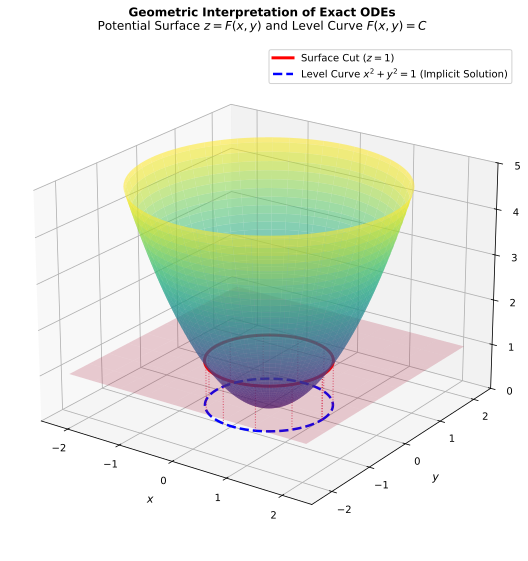

# Equações Diferenciais Exatas e Fatores Integrantes

## Forma Diferencial e o Critério de Exatidão

Uma equação diferencial ordinária de primeira ordem escrita na forma diferencial:

$$M(x,y) \, dx + N(x,y) \, dy = 0$$

é dita **exata** em uma região simplesmente conexa $R \subset \mathbb{R}^2$ se a expressão do lado esquerdo for o diferencial total $dF$ de alguma função multivariada $F(x,y)$, denominada **função potencial**.

Se tal função $F(x,y)$ existe, seu diferencial total é definido por:

$$dF = \frac{\partial F}{\partial x} dx + \frac{\partial F}{\partial y} dy = M(x,y) dx + N(x,y) dy$$

o que estabelece a correspondência direta entre as funções da EDO e as derivadas parciais do potencial:

$$\frac{\partial F}{\partial x} = M(x,y) \quad \text{e} \quad \frac{\partial F}{\partial y} = N(x,y)$$

Consequentemente, a EDO reduz-se à afirmação $dF = 0$, cuja solução geral é dada pela família de relações implícitas $F(x,y) = C$.

---

## Fundamentação Geométrica: Soluções Implícitas e Curvas de Nível

Existe um equívoco conceitual frequente ao estudar EDOs Exatas: confundir a **função potencial $F(x,y)$** com a **solução da equação diferencial**.

### A Diferença entre a Superfície 3D e a Solução da EDO

A função potencial $z = F(x,y)$ pertence ao Cálculo Multivariável e define uma **superfície tridimensional** no espaço $\mathbb{R}^3$, onde a cada par $(x,y)$ associa-se uma altura $z$. No entanto, a equação diferencial tratada é **ordinária** (descreve a variação de uma única variável dependente $y$ em relação a $x$). 

A função $F(x,y)$ em si não é a solução da EDO, mas sim um construto geométrico auxiliar.

### O Plano Seccionante e a Curva de Nível

Ao impor a condição de exatidão $dF = 0$, exige-se que o valor de $F(x,y)$ permaneça rigorosamente constante. Graficamente, isso equivale a interceptar a superfície tridimensional $z = F(x,y)$ com um **plano horizontal** fixado na altura $z = C$.

Se imaginarmos esse plano horizontal $z = C$ fatiando a superfície $z = F(x,y)$, o contorno ou a marca deixada por essa intersecção é uma linha unidimensional: a **curva de nível** $F(x,y) = C$.

A projeção dessa linha no plano cartesiano $xy$ é a verdadeira solução da EDO Ordinária. Ela descreve a trajetória $y(x)$ de uma partícula que se desloca ao longo da superfície mantendo a altitude constante ($dz = 0$).

Por essa razão, a solução de uma EDO Exata é expressa na **forma implícita** $F(x,y) = C$.

### Exemplo Numérico Intuitivo (Sem EDO)

Para visualizar este conceito de forma isolada, considere a função multivariada simples:

$$F(x,y) = x^2 + y^2$$

No espaço tridimensional $\mathbb{R}^3$, a equação $z = x^2 + y^2$ descreve um **paraboloide de revolução** (uma superfície em formato de taça).

Ao fixarmos uma altura específica, por exemplo $z = 4$, estamos interceptando essa taça com o plano horizontal na altura $4$:

$$x^2 + y^2 = 4$$

A intersecção da superfície 3D com o plano $z = 4$ resulta em uma circunferência de raio $2$. A equação $x^2 + y^2 = 4$ não descreve a taça em 3D, mas sim a circunferência bidimensional no plano $xy$. 

Se isolarmos $y$, obtemos as soluções explícitas $y(x) = \pm\sqrt{4 - x^2}$. É essa relação unidimensional $y(x)$ (a marca do corte) que corresponde ao objeto de estudo de uma EDO ordinária.

### Conexão Algébrico-Geométrica: Estudo de Caso

Para visualizar a correspondência direta entre a EDO e a ilustração tridimensional acima, considere a equação diferencial exata:

$$x \, dx + y \, dy = 0$$

#### Reconstrução da Função Potencial

Aplicando o método da integração por união de termos:

* $I_1 = \int x \, dx = \frac{x^2}{2}$
* $I_2 = \int y \, dy = \frac{y^2}{2}$

Unindo os termos e reescalando a constante de integração arbitrária, obtemos a função potencial:

$$F(x,y) = x^2 + y^2$$

#### Interpretação Física e Geométrica

* **A Superfície Potencial:** A equação $z = x^2 + y^2$ define o paraboloide de revolução exibido no gráfico 3D.
* **O Plano Seccionante:** A condição $dF = 0$ impõe que a altitude permaneça constante. Para a constante $C = 1$, corta-se o paraboloide com o plano horizontal na altura $z = 1$.
* **A Solução Implícita:** A marca de intersecção projetada no plano cartesiano $xy$ é a curva de nível:

$$x^2 + y^2 = 1$$

Ao isolar $y$, encontramos as soluções explícitas $y(x) = \pm\sqrt{1 - x^2}$, que descrevem a trajetória unidimensional sobre a qual o diferencial $dF$ é nulo.

---

## Teorema do Critério de Exatidão

Pelo Teorema de Schwarz sobre a simetria das derivadas mistas, se $F(x,y)$ for suave, suas derivadas de segunda ordem satisfazem $\frac{\partial^2 F}{\partial y \partial x} = \frac{\partial^2 F}{\partial x \partial y}$.

Como $M = \frac{\partial F}{\partial x}$ e $N = \frac{\partial F}{\partial y}$, substituindo essas igualdades obtemos a condição necessária e suficiente para que $M dx + N dy = 0$ seja exata:

$$\frac{\partial M}{\partial y} = \frac{\partial N}{\partial x}$$

---

## Métodos de Reconstrução da Função Potencial $F(x,y)$

Existem duas abordagens equivalentes para reconstruir $F(x,y)$ após a confirmação da exatidão.

### Método 1: Construção por Integração Parcial e Ajuste de Fronteira

1. **Integração Parcial em $x$:** Integra-se $M(x,y)$ em relação a $x$, considerando $y$ constante:
   $$F(x,y) = \int M(x,y) \, dx + g(y)$$
   onde $g(y)$ representa os termos dependentes exclusivamente de $y$ que foram eliminados ao derivar parcialmente em relação a $x$.

2. **Determinação de $g(y)$:** Deriva-se a expressão encontrada em relação a $y$ e iguala-se ao termo conhecido $N(x,y)$:
   $$\frac{\partial F}{\partial y} = \frac{\partial}{\partial y}\left( \int M(x,y) \, dx \right) + g'(y) = N(x,y)$$
   Isola-se $g'(y)$ e integra-se em relação a $y$ para determinar $g(y)$.

3. **Montagem da Solução:** Substitui-se $g(y)$ em $F(x,y)$ e iguala-se à constante $C$:
   $$F(x,y) = C$$

---

### Método 2: Reconstrução por União de Termos Não Repetidos

#### Fundamentação Teórica

Ao derivar $F(x,y)$ parcialmente em relação a $x$, os termos exclusivos de $y$ anulam-se. Ao derivar em relação a $y$, os termos exclusivos de $x$ anulam-se. Os termos mistos sobrevivem em ambas as derivadas.

Assim, integrando $M(x,y)$ em $x$ e $N(x,y)$ em $y$ independentemente, recuperam-se todos os componentes da função $F(x,y)$, com a única ressalva de que os termos mistos aparecem duplicados.

#### Algoritmo do Método

1. Calcule a integral indefinida de $M(x,y)$ em relação a $x$:
   $$I_1(x,y) = \int M(x,y) \, dx$$

2. Calcule a integral indefinida de $N(x,y)$ em relação a $y$:
   $$I_2(x,y) = \int N(x,y) \, dy$$

3. Monte $F(x,y)$ unindo todos os termos de $I_1$ e $I_2$, escrevendo os termos idênticos apenas uma vez:
   $$F(x,y) = \text{União sem repetição de } \{I_1(x,y), I_2(x,y)\}$$

4. Formule a solução geral igualando a união obtida a $C$.

---

## Fatores Integrantes: A Origem da Regra do Produto

Quando $\frac{\partial M}{\partial y} \neq \frac{\partial N}{\partial x}$, a EDO não é exata. Procura-se uma função $\mu(x,y)$ para reescalar a equação, tornando-a exata:

$$\mu(x,y) M(x,y) \, dx + \mu(x,y) N(x,y) \, dy = 0$$

A nova equação deve satisfazer o critério de Schwarz:

$$\frac{\partial}{\partial y}\bigl[ \mu M \bigr] = \frac{\partial}{\partial x}\bigl[ \mu N \bigr]$$

Aplicando a **Regra do Produto para Derivadas Parciais** em ambos os lados:

$$\mu \frac{\partial M}{\partial y} + M \frac{\partial \mu}{\partial y} = \mu \frac{\partial N}{\partial x} + N \frac{\partial \mu}{\partial x}$$

Reagrupando os termos que contêm $\mu$:

$$\mu \left( \frac{\partial M}{\partial y} - \frac{\partial N}{\partial x} \right) = N \frac{\partial \mu}{\partial x} - M \frac{\partial \mu}{\partial y}$$

Esta igualdade é uma Equação Diferencial Parcial (EDP). Para transformá-la em uma EDO Ordinária resolvível por separação de variáveis, assume-se que $\mu$ depende de apenas uma das variáveis:

### Caso 1: Fator Integrante Dependente Apenas de $x$
Se $\mu = \mu(x)$, então $\frac{\partial \mu}{\partial y} = 0$ e a derivada parcial $\frac{\partial \mu}{\partial x}$ passa a ser a derivada ordinária $\frac{d\mu}{dx}$. A equação reduz-se a:

$$\mu \left( \frac{\partial M}{\partial y} - \frac{\partial N}{\partial x} \right) = N \frac{d\mu}{dx} \implies \frac{1}{\mu} \frac{d\mu}{dx} = \frac{\dfrac{\partial M}{\partial y} - \dfrac{\partial N}{\partial x}}{N}$$

Para que $\mu(x)$ possa ser determinado exclusivamente em função de $x$, a razão do lado direito **deve depender apenas de $x$**. Denotando essa razão por $f(x)$:

$$f(x) = \frac{\dfrac{\partial M}{\partial y} - \dfrac{\partial N}{\partial x}}{N} \implies \mu(x) = e^{\int f(x) \, dx}$$

### Caso 2: Fator Integrante Dependente Apenas de $y$
Se $\mu = \mu(y)$, então $\frac{\partial \mu}{\partial x} = 0$. Por raciocínio análogo:

$$g(y) = \frac{\dfrac{\partial N}{\partial x} - \dfrac{\partial M}{\partial y}}{M} \implies \mu(y) = e^{\int g(y) \, dy}$$

---

## Exemplos Resolvidos

### Exemplo 1: Equação com Exatidão Direta
Determine a solução geral da equação diferencial ordinária:

$$(2x y + 3) \, dx + (x^2 - 1) \, dy = 0$$

**Resolução:**

**1. Verificação do Critério de Exatidão:**
$M(x,y) = 2xy + 3$ e $N(x,y) = x^2 - 1$.

$$\frac{\partial M}{\partial y} = 2x, \quad \frac{\partial N}{\partial x} = 2x$$

Como $\dfrac{\partial M}{\partial y} = \dfrac{\partial N}{\partial x} = 2x$, o critério de Schwarz é satisfeito e a EDO é exata.

**2. Reconstrução de $F(x,y)$ pelo Método da União de Termos:**
* $I_1 = \int (2xy + 3) \, dx = x^2 y + 3x$
* $I_2 = \int (x^2 - 1) \, dy = x^2 y - y$

Unindo os termos sem repetição: $F(x,y) = x^2 y + 3x - y$.

**3. Solução Geral:**

$$x^2 y + 3x - y = C$$

---

### Exemplo 2: Equação com Fator Integrante Mono-Variável

**Determine a solução geral da equação diferencial ordinária:**

$$(2y + x^2) \, dx + x \, dy = 0, \quad (x > 0)$$

**Resolução:**

**1. Verificação do Critério de Exatidão:**

Identificam-se $M(x,y) = 2y + x^2$ e $N(x,y) = x$.

$$\frac{\partial M}{\partial y} = 2, \quad \frac{\partial N}{\partial x} = 1$$

Como $\dfrac{\partial M}{\partial y} = 2 \neq 1 = \dfrac{\partial N}{\partial x}$, a equação não é exata.

**2. Determinação do Fator Integrante $\mu(x)$:**

Calculando a razão de dependência em relação a $N(x,y)$:

$$\frac{\dfrac{\partial M}{\partial y} - \dfrac{\partial N}{\partial x}}{N} = \frac{2 - 1}{x} = \frac{1}{x}$$

Como o resultado $f(x) = \dfrac{1}{x}$ depende **exclusivamente de $x$**, o fator integrante $\mu(x)$ é calculado diretamente por:

$$\mu(x) = e^{\int f(x) \, dx} = e^{\int \frac{1}{x} \, dx} = e^{\ln x} = x$$

Multiplicando toda a EDO original por $\mu(x) = x$:

$$x(2y + x^2) \, dx + x(x) \, dy = 0 \implies (2xy + x^3) \, dx + x^2 \, dy = 0$$

**3. Verificação da Nova EDO Exata:**

Para a nova equação, $M_1(x,y) = 2xy + x^3$ e $N_1(x,y) = x^2$:

$$\frac{\partial M_1}{\partial y} = 2x, \quad \frac{\partial N_1}{\partial x} = 2x$$

A nova equação é estritamente exata.

**4. Reconstrução do Potencial $F(x,y)$ (Método da União de Termos):**

- Integrando $M_1$ em relação a $x$:
    
    $$I_1 = \int (2xy + x^3) \, dx = x^2 y + \frac{x^4}{4}$$
    
- Integrando $N_1$ em relação a $y$:
    
    $$I_2 = \int x^2 \, dy = x^2 y$$
    

Unindo os termos de $I_1$ e $I_2$ sem repetição:

$$F(x,y) = x^2 y + \frac{x^4}{4}$$

**5. Solução Geral:**

Igualando a função potencial à constante $C$:

$$x^2 y + \frac{x^4}{4} = C \implies y(x) = \frac{C}{x^2} - \frac{x^2}{4}$$